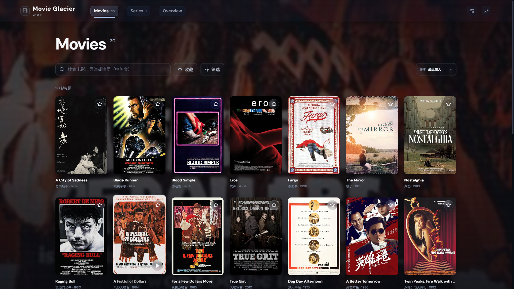
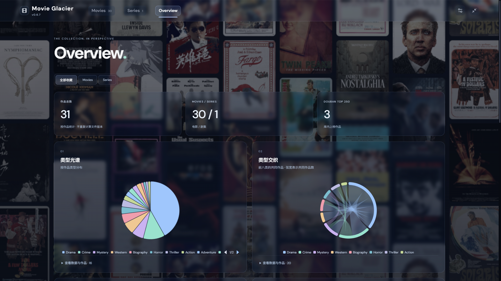

# Movie Glacier

macOS / Windows 本地影视库：扫描电影与剧集，以动态海报卡片浏览收藏，查看中英文资料和评分，并使用本机播放器播放原文件。

A macOS and Windows desktop library for local movies and series. Browse animated poster cards, explore bilingual metadata and ratings, and play original files with your preferred player.

[下载 / Download](https://github.com/Glacier95/movie-glacier/releases/latest) · [问题反馈 / Issues](https://github.com/Glacier95/movie-glacier/issues) · [MIT License](LICENSE)

## 主要功能 · Features

- **影视整理 / Library management**：多目录扫描、电影与剧集识别、蓝光目录及同片多版本。Scan multiple folders, recognize movies and episodes, and manage Blu-ray folders and alternate versions.
- **海报浏览 / Poster browsing**：搜索、筛选、排序、收藏和资料手动修正。Search, filter, sort, save favorites, and correct metadata.
- **资料与评分 / Metadata and ratings**：支持 TMDB、OMDb、豆瓣资料及 IMDb／豆瓣评分。Supports metadata from TMDB, OMDb, and Douban, with IMDb and Douban ratings.
- **双榜单 / Top 250 charts**：豆瓣与 IMDb Top 250 独立筛选、详情排名及片库统计；更新库时每七天刷新，刷新全部资料可强制更新，访问失败保留完整缓存。Filter by Douban and IMDb Top 250, view ranks and collection counts. Charts refresh weekly during library updates or on a full metadata refresh; failed requests preserve the last complete chart.
- **片库概览 / Collection overview**：交互图表展示类型、年代、地区、评分与演职员统计。Explore genres, years, regions, ratings, and director/cast statistics through interactive charts.
- **界面与播放 / Appearance and playback**：海报连续展开、轻微倾斜与按压回弹，支持系统减少动态效果；中英文界面及可调毛玻璃。Shared poster transitions, subtle tilt and press feedback, system reduced-motion support, bilingual UI and adjustable glass surfaces. New libraries use a 16px panel blur and 68% panel opacity; existing saved appearance settings are preserved.
- **Mac 适配 / macOS support**：原生窗口按钮及菜单、Dock 重开、⌘F 搜索、⌘, 设置、⌘1/2/3 切换视图；自动识别 IINA / VLC，可选其他 `.app` 或系统默认播放器。Native window controls and menus, Dock reopening, standard shortcuts, and IINA / VLC / default-player support.

## 界面预览 · Screenshots

**海报片库 / Poster library** — 浏览、搜索和收藏本地影视。Browse, search, and favorite your local collection.



**片库概览 / Collection overview** — 通过交互图表查看片库统计。Explore collection statistics through interactive charts.



## 快速开始 · Quick start

1. Windows 可从 [Releases](https://github.com/Glacier95/movie-glacier/releases/latest) 安装现有版本，并另行安装 PotPlayer。Mac 版本可按下方命令本地构建，打开 `release/` 中的 DMG 并拖入 Applications。Windows: install the existing release and PotPlayer. macOS: build locally using the commands below, open the DMG in `release/`, and drag the app to Applications.
2. 首次启动时选择媒体目录、确认播放器路径，填写自己的 OMDb API Key 或 TMDB 读取令牌。Choose media folders, confirm the player path, and enter your own OMDb API key or TMDB read access token.
3. 完成初次扫描后即可浏览；添加新文件后点击“更新库”。界面语言可在设置中切换。Browse after the initial scan; click “Update library” when new files arrive. Change the interface language in Settings.

凭据申请：[TMDB](https://www.themoviedb.org/settings/api) · [OMDb](https://www.omdbapi.com/apikey.aspx)。豆瓣遇到验证时，可在应用内打开官方网页完成验证并重试。

Get credentials from TMDB or OMDb using the links above. If Douban requests verification, complete it on the official page opened within the app, then retry.

## 版本更新 · Version history

根据开发记录整理，每个版本仅概括主要变化。早期版本为本地迭代记录。

Summarized from development records, with the main changes for each version. Earlier entries describe local development builds.

| 版本 / Version | 更新概括 | Summary |
| --- | --- | --- |
| **0.7.0（本地开发版）** | 新增 Mac 构建与原生操作，完善卡片连续动效；修复资料源故障互相阻断、相邻年份抢先匹配、Finder 隐藏文件入库及海报缓存丢失。 | Local development build: macOS packaging and native interactions, shared card transitions, isolated provider failures, safer year matching, Finder sidecar filtering and preserved artwork. |
| **0.6.9** | 修复 AKA 与中英文片名匹配，豆瓣可回填 IMDb 编号并自动重试英文资料。 | Fix AKA and bilingual title matching; recover IMDb IDs from Douban and retry English metadata automatically. |
| **0.6.8** | 新增 IMDb Top 250 筛选、排名与统计，更新默认玻璃及海报效果。 | Add IMDb Top 250 filters, ranks and statistics; refresh default glass and poster effects. |
| **0.6.7** | 演职员榜单改为 Top 10，修复明细展开收起导致页面变长。 | Top 10 director/cast rankings; fix layout growth when toggling details. |
| **0.6.6** | 返回片库恢复浏览位置，增加细分评分区间与统计摘要。 | Restore browsing position; add finer rating bins and summary statistics. |
| **0.6.5** | 修复数字片名、季集与年份匹配，完善重扫纠错和 NFO 读取。 | Improve numeric titles, episode/year matching, rescan repairs, and NFO handling. |
| **0.6.4** | 增加类型弦图、地区关系气泡图与演员排行，完善统计布局。 | Add genre chords, region relationship bubbles, and cast rankings; refine chart layout. |
| **0.6.3** | 扩展面板与海报背景外观设置，增加导演排行。 | Expand panel/background appearance controls and add director rankings. |
| **0.6.2** | 海报墙支持模糊、不透明度、速度和饱和度调节。 | Add poster-wall blur, opacity, speed, and saturation controls. |
| **0.6.1** | 调整统计图表和毛玻璃效果，修复海报墙滚动闪烁。 | Refine charts and glass styling; fix poster-wall scrolling flicker. |
| **0.6.0** | 新增交互式 Overview 与动态海报墙，调整操作入口和版本显示。 | Introduce interactive Overview and an animated poster wall; reorganize controls and show the version. |
| **0.5.0** | 数据迁至安装目录，完善升级与卸载，增加中英文切换。 | Move app data beside the installation, improve upgrades/uninstall, and add language switching. |
| **0.4.2** | 详情显示源名称与大小，增加背景模糊设置，完善蓝光目录大小统计。 | Show source names/sizes, add background blur control, and improve Blu-ray folder sizing. |
| **0.4.1** | 修复后台窗口退出，启动直接恢复片库，减少持续动画。 | Fix exit behavior with background windows, restore the library on startup, and reduce continuous animation. |
| **0.4.0** | 增加 IMDb 到豆瓣的编号匹配，精简抓取日志，加入海报色彩背景。 | Add IMDb-to-Douban ID matching, simplify scrape logs, and introduce poster-based backgrounds. |
| **0.3.6** | 补充并保存中文资料，调整双语展示，增加字幕搜索入口。 | Store Chinese metadata, refine bilingual presentation, and add subtitle search. |
| **0.3.5** | 改进豆瓣搜索与评分匹配，增加请求间隔和失败重试。 | Improve Douban lookup/rating matching, request pacing, and retries. |
| **0.3.4** | 更新提示支持关闭，排序改为支持键盘操作的深色菜单。 | Make update notices dismissible and add a keyboard-accessible dark sorting menu. |
| **0.3.3** | 增加搜索清空、资源定位及单片重抓，优化标题和详情展示。 | Add search clearing, file location, and per-title refresh; refine titles and details. |
| **0.3.2** | 增加 OMDb 自动回退，改善影片匹配、海报下载及错误提示。 | Add automatic OMDb fallback and improve matching, artwork downloads, and errors. |
| **0.3.1** | 增加凭据状态、代理设置、连接测试和逐条抓取日志。 | Add credential status, proxy settings, connection checks, and per-title scrape logs. |
| **0.3.0** | 支持多目录与收藏，完善界面过渡和减少动态效果。 | Add multiple folders and favorites; refine transitions and reduced-motion support. |
| **0.2.0** | 精简安装包，增加首次配置、资料编辑、演职员搜索与全屏。 | Reduce installer size; add onboarding, metadata editing, people search, and fullscreen. |
| **0.1.0** | 首版：本地扫描、海报浏览、电影／剧集详情、评分筛选和播放器调用。 | Initial build: local scanning, poster browsing, movie/series details, rating filters, and player integration. |

## 数据与构建 · Data and build

媒体目录只读。Mac 安装版的数据保存在 `~/Library/Application Support/Movie Glacier`，不写入 `.app` 包；Windows 安装版和开发模式仍使用安装目录或项目目录下的 `user-data`。更新保留数据，备份前先退出应用。

Media folders are read-only. Packaged macOS builds store data in `~/Library/Application Support/Movie Glacier`, outside the app bundle. Windows and development builds retain `user-data` beside the installation or in the project. Updates preserve data. Quit before making a backup.

构建环境 / Build requirements：macOS 或 Windows、Node.js 24、pnpm 11。

Mac 构建默认使用当前机器架构，另提供 Intel 构建命令。当前 Mac 包为本地 ad-hoc 签名，未做 Apple 公证，也未发布到上游 Releases。

Mac builds default to the host architecture; an explicit Intel build is also available. Packaging runs in a temporary local folder to avoid iCloud/Finder attributes interfering with signing, then copies the DMG, ZIP and SHA256SUMS.txt into `release/`. These local builds use ad-hoc signing, are not Apple-notarized, and have not been published to upstream Releases.

```sh
pnpm install --frozen-lockfile
pnpm build
pnpm start

# Unit tests and isolated native-app checks
pnpm test
pnpm test:smoke
pnpm test:desktop
pnpm test:metadata

# Build on macOS (Apple Silicon or Intel host)
pnpm dist:mac
# Cross-build an Intel Mac installer on macOS
pnpm dist:mac:intel
# Build the Windows installer on Windows
pnpm dist
```

`test:desktop` uses 80 synthetic entries and locally generated fictional artwork. It checks shared poster transitions, scroll and focus restoration, keyboard shortcuts, modal focus, narrow layouts, reduced motion and macOS window reopening. `test:metadata` uses deterministic provider substitutes to check that verification and network failures leave other providers running; it does not verify live provider availability. All test data stays under ignored `.cache/` directories.

## 开源与第三方服务 · License and third-party services

源码采用 [MIT 许可证](LICENSE)，第三方依赖保留各自许可证。影视文件、用户片库、API 密钥和网页会话不随项目分发；外部资料及服务遵循相应提供方的条款与授权。

Source code is licensed under MIT; dependencies retain their own licenses. Media files, user libraries, API keys, and browser sessions are not distributed with the project. External metadata and services remain subject to their providers' terms and permissions.
